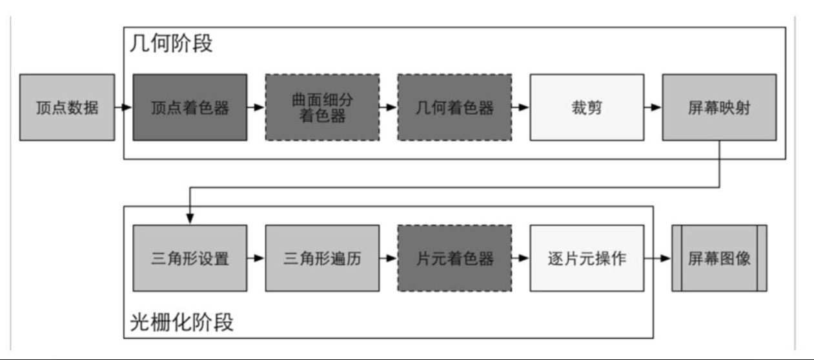
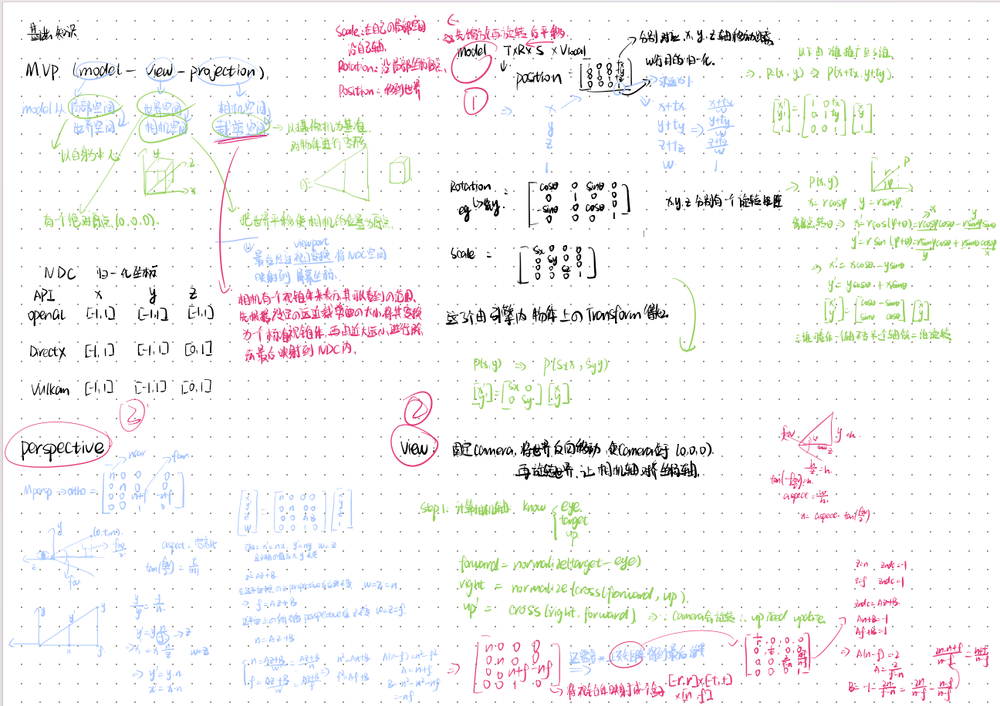
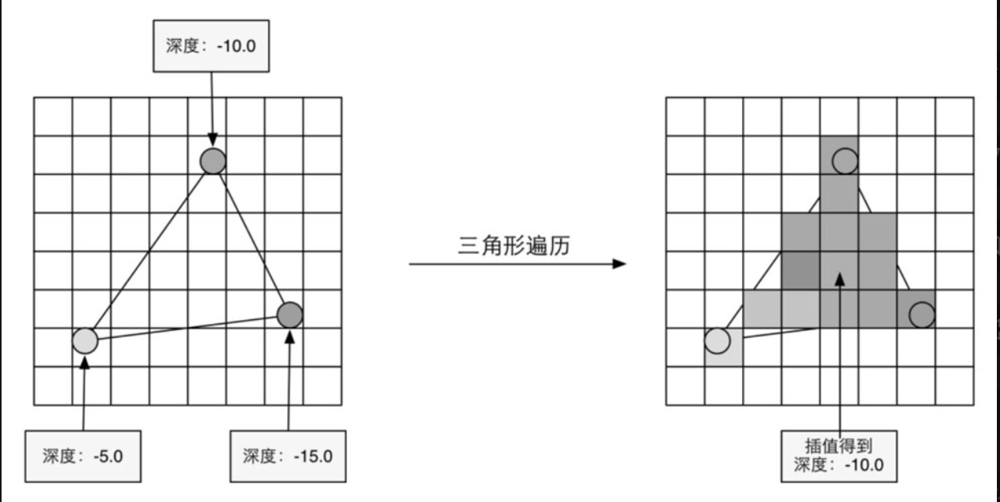
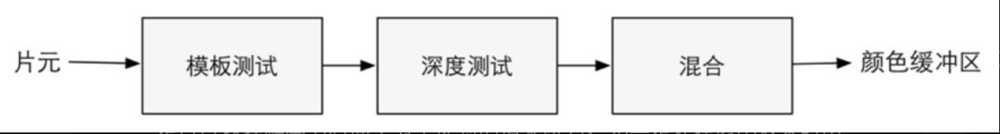
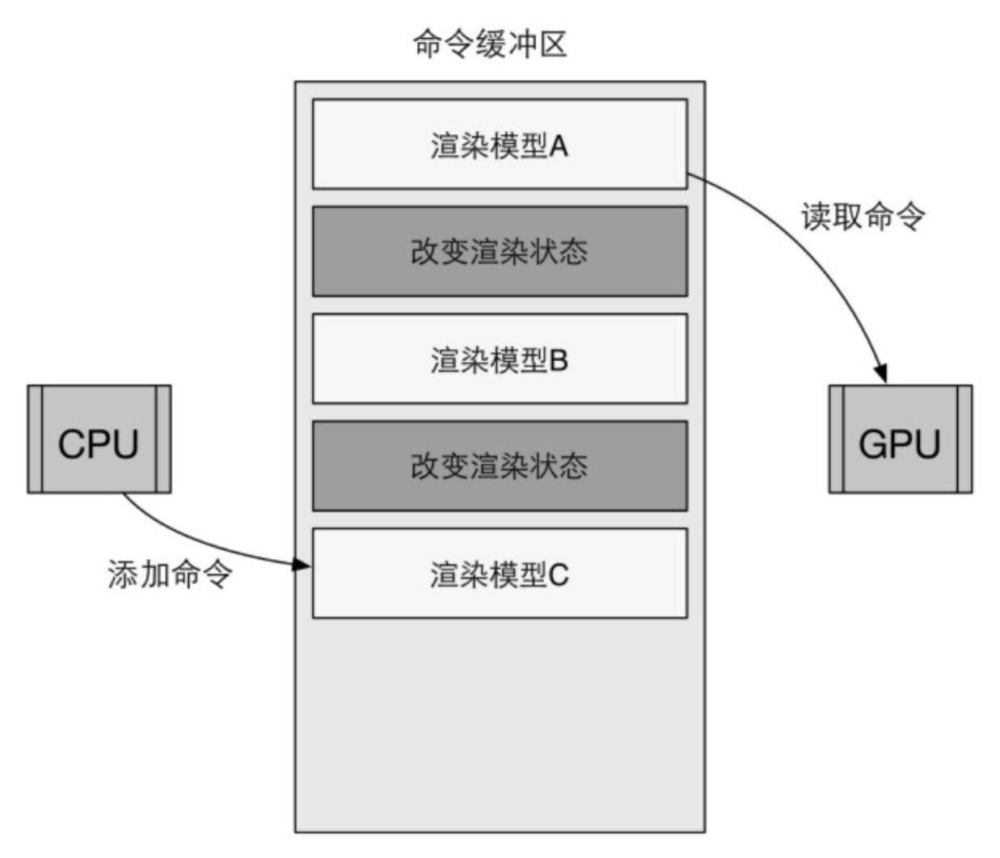

+++
date = '2026-10-14T10:00:00+08:00'
draft = false
title = 'UnityShader入门精要 第二章'
description = '一句话摘要'
categories = ['shader']
showTableOfContents = true

+++



## 第二章 渲染器流水线

- 渲染流程：**应用阶段、几何阶段、光栅化阶段**

  - 应用阶段（CPU进行）

    - 获取场景数据

    - 粗粒度剔除（将不可见物体剔除渲染列表）
    - 设置每个模型的渲染状态
    - 输出**渲染图元**（渲染所需的几何信息）

  - 几何阶段（GPU进行）

    - 对渲染图元进行处理
    - 将顶点坐标变换到屏幕空间中
    - 输出屏幕空间的二维坐标、每个顶点对应的信息

  - 光栅化阶段（GPU进行）

    - 判断像素是否需要被绘制
    - 对顶点数据进行插值和逐像素计算

  但现代渲染有例外：**GPU Driven Rendering**。它可以把一部分原本属于应用阶段的工作，比如视锥剔除、遮挡剔除、LOD 选择、间接绘制参数生成，放到 GPU 的 Compute Shader 里做。这时“应用阶段”的部分职责被 GPU 化了。不过游戏逻辑、物理、场景管理、资源管理、命令提交等，通常仍然由 CPU 主导。

- CPU到GPU

  - CPU（应用阶段）

    - 把数据加载到显存中

      数据从硬盘（HDD）中加载到系统内存（RAM，CPU的内存），然后网格和纹理等数据加载到显存（VRAM，GPU的内存）。因为显卡对显存的访问速度更快，且大多显卡无直接权限访问RAM。移动到显存后的数据可以在RAM中删除（如有需要也可以不删除）

    - 设置渲染状态

      状态定义场景中网格被渲染的方式

    - 调用DrawCall

      DrawCall（渲染命令），CPU调用其告诉GPU可以按当前设置来进行渲染。

      一个DrawCall会指向本次调用需要渲染的图元列表

- GPU流水线（输入由DrawCall指定的顶点数据）

  

  - 顶点着色器 Vertex Shader（完全可编程）：顶点的空间变换、顶点着色等功能

    从CPU获取顶点，每个顶点调用一次，不知顶点与顶点间的关系，并行化处理每个数据，速度快。对顶点进行坐标变换和逐顶点光照。

    - 坐标变换：MVP，法线变换，切线/副切线变换，纹理坐标变换，顶点动画，自定义变换。法线变换不能用MVP，是因为非均匀缩放会破坏法线，通常用模型矩阵的逆转置。

      | 数据     | 常用变换                    | 目标               |
      | :------- | :-------------------------- | :----------------- |
      | 顶点位置 | Model → View → Projection   | 裁剪空间           |
      | 法线     | 模型矩阵的逆转置            | 世界/观察空间      |
      | 切线     | 模型矩阵 3×3，必要时正交化  | 世界/观察空间      |
      | 副切线   | 法线 × 切线，再乘手性       | 世界/观察空间      |
      | UV       | 直接传，或乘纹理变换矩阵    | UV 空间            |
      | 顶点动画 | 骨骼矩阵、Morph、程序化修改 | 模型空间或世界空间 |
      | 顶点颜色 | 直接传，插值                | 片元               |

    - 逐顶点光照：对每个顶点计算光照，得到该顶点的颜色，然后把这个颜色传给光栅化阶段，由 GPU 在三角形内部插值，最终得到每个片元的颜色。性能好，但是质量低，不适合高光（非线性很强，插值后不准确），大三角形和精细光照，现代渲染常用逐像素光照。

  - 曲面细分着色器 Tessellation Shader（可选）：细分图元，根据距离，曲率等在面片内部生成大量的新顶点，并且把这些顶点连接成许多小三角形。

  - 几何着色器 Geometry Shader（可选）：逐图元着色、产生更多图元

  - 裁剪 Clipping（可配置，不可编程）：将相机外的顶点裁剪掉，并且剔除某些三角图元的面片。

    - 正面/背面（OpenGL中的逆时针为正面）：根据三角形在屏幕空间中的顶点绕序，判断它面向相机还是背对相机。
    - 背面剔除：把背对相机的三角形丢掉，常规实体渲染默认选择。
    - 正面剔除：把面向相机的三角形丢掉，阴影贴图、内部渲染、反射、天空盒内部。
      - 阴影贴图：因为背面深度>正面深度，能减少表面把自己判定成阴影的概率，减少自遮挡（Shadow acne）
      - 反射：反射的时候相机需要根据反射平面做镜像，并且用这个镜像相机来渲染场景，但是镜像相机中的正面应该是之前相机的背面，也可以在渲染平面反射纹理的时候翻转剔除模式。
    - 不剔除：透明物体、树叶、布料、双面材质。
      - 薄片没有厚度，正面和背面几乎共面，剔除可能会导致物体消失，且可能从不同角度看到正面和被骗。

  - 屏幕映射 Screen Mapping（不可配置和编程）：把 NDC 坐标转换成屏幕坐标，屏幕坐标和Z坐标共同构成**窗口坐标系**

    OpenGL和DirectX的屏幕坐标系差异。对于一张512＊512大小的图像，在OpenGL中其（0, 0）点在左下角，而在DirectX中其(0, 0)点在左上角

    

  - 三角形设置 Triangle Setup（固定函数）：由三角形的顶点计算一个三角网格表示信息。

  - 三角形遍历 Triangle Traversal （固定函数）/扫描变换 Scan Conversion：检测每个像素是否被一个三角网格所覆盖，如果覆盖就生成一个片元，片元的状态由三个顶点的信息进行插值得到。

    

  - 片元着色器 Fragment Shader （完全可编程）/像素着色器 Pixel Shader：根据上一步插值后的片元信息，来计算该片元的输出颜色。可以完成纹理采样等渲染技术。只能影响单个片元，无法将结果发送给别的片元（例外：访问导数信息，gradient，derivative，硬件以 2×2 片元块为单位执行，允许通过 `dFdx/dFdy/fwidth` 读取相邻片元属性的屏幕空间差分。这是有限的结构化例外，主要用于 mipmap 选择、边缘检测、法线重建等。它不是任意通信，也不能读邻居的最终颜色。）

  - 逐片元操作 Per-Fragment Operations （不可编程，可配置）/输出合并阶段 Output-Merger：修改颜色，深度缓冲，混合。

    - 决定每个片元的可见性
    - 将该片元颜色与颜色缓冲区的颜色合并

    

    - 模板测试：GPU会首先读取（使用读取掩码）模板缓冲区中该片元位置的模板值，然后将该值和读取（使用读取掩码）到的参考值（reference value）进行比较，然后选择是否丢弃。一般用于限制渲染区域，或者渲染阴影，轮廓渲染等。
    - 深度测试：GPU会把该片元的深度值和已经存在于深度缓冲区中的深度值进行比较。
    - 混合：不透明物体可以用计算到的只覆盖掉颜色缓冲区中的像素值，但是半透明就需要使用混合操作。
    - 以上测试一般在片元着色器之前，有些时候可能会产生冲突，发生冲突需要禁用提前测试。

  - 双重缓冲 Double Buffering：对场景的渲染是在幕后发生的（后置缓冲，Back Buffer），一旦场景渲染到后置缓冲中就与前置缓冲（Front Buffer）交换，从而使图像连续。

- 术语科普

  - OpenGL/DirectX：图像应用编程接口

  - HLSL/GLSL/CG：着色器语言

    - GLSL：跨平台，opengl提供，依赖硬件

    - HLSL：微软提供，与硬件无关，平台有限

    - CG：跨平台，根据平台来编译成不同的中间语言

- Draw Call：CPU调用图像编程接口，如OpenGL中的glDrawElements命令或者DirectX中的DrawIndexedPrimitive命令，以命令GPU进行渲染的操作。

  - 使用命令缓冲区，CPU写命令，GPU读命令，添加与读取相互独立。

    

  - DrawCall多了影响帧率，因为在每次调用Draw Call之前，CPU需要向GPU发送很多内容，包括数据、状态和命令等，GPU渲染很快，因此渲染速度往往快于CPU提交命令的速度

  - 减少DrawCall

    - 批处理 Batching：把很多小的DrawCall合并成一个大的Draw Call，再发送给GPU，然后在一个Draw Call中渲染它们。但要注意的是，使用批处理合并的网格将会使用同一种渲染状态。一般用于静态物体，因为动态物体每一帧都需要重新合并。
    - 避免使用大量很小的网格
    - 避免使用过多的材质

    

    

    

